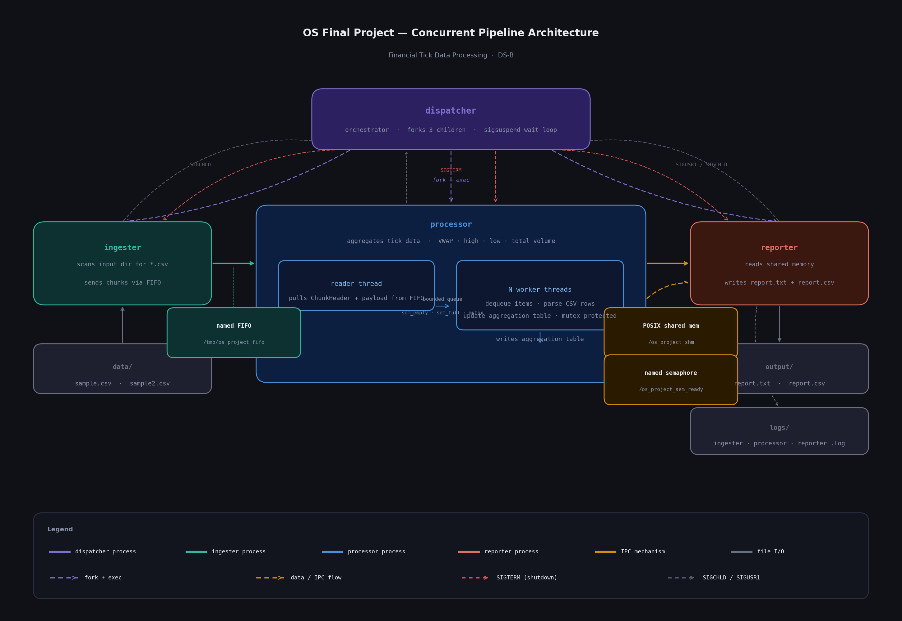

# Concurrent Financial Tick-Data Pipeline (C, POSIX)

[](https://github.com/ibrahimghauri009/posix-tick-pipeline/actions/workflows/build.yml)

A multi-process, multi-threaded pipeline that aggregates stock tick CSVs into per-symbol High, Low,
VWAP and total volume. Four cooperating processes communicate through a named pipe and POSIX shared
memory; worker threads consume a bounded queue guarded by mutexes and semaphores.

**Stack:** C (gcc, -Wall -Wextra) · POSIX threads · FIFOs · POSIX shared memory and semaphores · signals · Make · Bash



| Process | Role |
|---|---|
| `dispatcher` | Parses options, creates the IPC resources, forks and supervises the other processes, relays signals and cleans up |
| `ingester` | Scans the input folder and streams CSV chunks into the FIFO |
| `processor` | A reader thread fills a bounded queue (two semaphores + mutex) from the FIFO; N worker threads aggregate per-symbol statistics and write them to shared memory, then signal the reporter through a named semaphore |
| `reporter` | Attaches to shared memory and writes `report.txt` and `report.csv` |

Example output for the bundled sample data is in [`docs/sample_output/`](docs/sample_output).

> **Team project.** Operating Systems final project, FAST-NUCES (Spring 2026), by Ibrahim Ghauri and Vikram Kumar.

---

## System Requirements
- A Linux environment (Ubuntu 22.04 or higher is advised)
- GCC compiler including `pthread` library support
- Make utility

---

## Compilation Instructions

```bash
make
```

Executing this command generates four distinct executable files in the root directory:
`dispatcher`, `ingester`, `processor`, and `reporter`.

To remove compiled binaries and clean the workspace:
```bash
make clean
```

---

## Execution Guide

### Via the bash script (preferred method):
```bash
chmod +x run.sh
./run.sh -i ./data -o ./report -n 4 -q 16
```

**Available Parameters:**
| Parameter | Function | Default Value |
|------|-------------|---------|
| `-i` | Source folder containing CSV files | (mandatory) |
| `-o` | Destination folder for output reports | `report` |
| `-n` | Total worker threads | `4` |
| `-q` | Maximum capacity of the bounded queue | `16` |
| `-c` | Perform a clean build prior to execution | disabled |
| `-h` | Display the help menu | — |

### Executing the dispatcher manually:
```bash
./dispatcher -i ./data -o ./report -n 4 -q 16 \
    -f /tmp/os_project_fifo \
    -s /os_project_shm \
    -e /os_project_sem_ready
```

---

## Expected Input Structure

All CSV files located in the source folder need to adhere to the following schema:
```csv
SYMBOL,price,volume
AAPL,150.25,1000
GOOGL,2801.50,300
```
- First Column: The stock ticker (string format)
- Second Column: The execution price (floating-point number)
- Third Column: The quantity of shares traded (floating-point number)

---

## Generated Output

The pipeline will create two distinct files within the designated report folder:

**report.txt** — Formatted for easy reading:
```text
SYMBOL        HIGH        LOW       VWAP    TOTAL_VOLUME
AAPL        151.00     149.80   150.5488            4300
```

**report.csv** — Structured for further programmatic use:
```csv
symbol,high,low,vwap,total_volume
AAPL,151.00,149.80,150.5488,4300
```

---

## Calculation Rules (Tick Data)

| Field | Computation Method |
|--------|---------|
| VWAP (Volume-Weighted Average Price) | `sum(price × volume) / sum(volume)` |
| High Price | The highest `price` recorded among all transactions |
| Low Price | The lowest `price` recorded among all transactions |
| Total Volume | The accumulated `volume` of all transactions |

---

## Logging Mechanisms

Individual child processes will output their status and errors to `logs/<process_name>.log`:
- `logs/ingester.log`
- `logs/processor.log`
- `logs/reporter.log`

For debugging purposes, each entry is prefixed with `[PID=X PPID=Y]` to track process IDs.

---

## Graceful Termination

You can safely abort the process by pressing `Ctrl+C` whenever necessary. In this event, the dispatcher ensures:
1. A `SIGTERM` signal is relayed to all active child processes.
2. It waits for the child processes to terminate correctly.
3. All Inter-Process Communication (IPC) resources (Semaphore, FIFO, Shared Memory) are successfully unlinked.
4. The program halts with an exit status of `130`.

To confirm that no leftover IPC mechanisms remain after stopping:
```bash
ipcs -m                   # Should return empty for /os_project_shm
ls /tmp/os_project_fifo   # Should indicate no file found
```

---

## Program Exit Status

| Status Code | Description |
|------|---------|
| 0    | Successful completion |
| 10   | Invalid command-line arguments provided |
| 20   | Failed to initialize Inter-Process Communication (IPC) |
| 30   | A child process terminated abnormally |
| 40   | Input/Output error encountered |
| 130  | Graceful termination via SIGINT (`Ctrl+C`) |
| 143  | Graceful termination via SIGTERM |

## Licence

MIT; see `LICENSE`.
